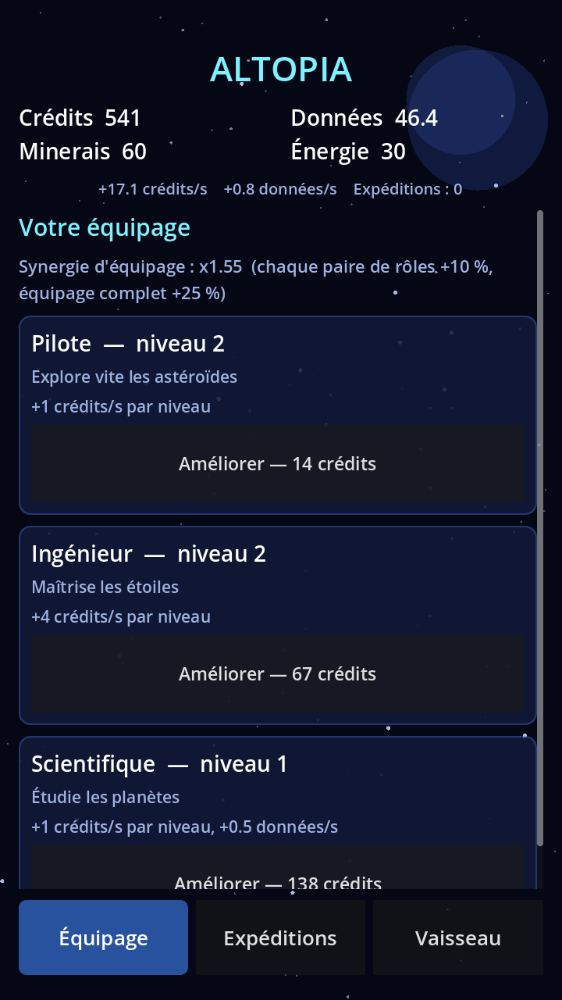
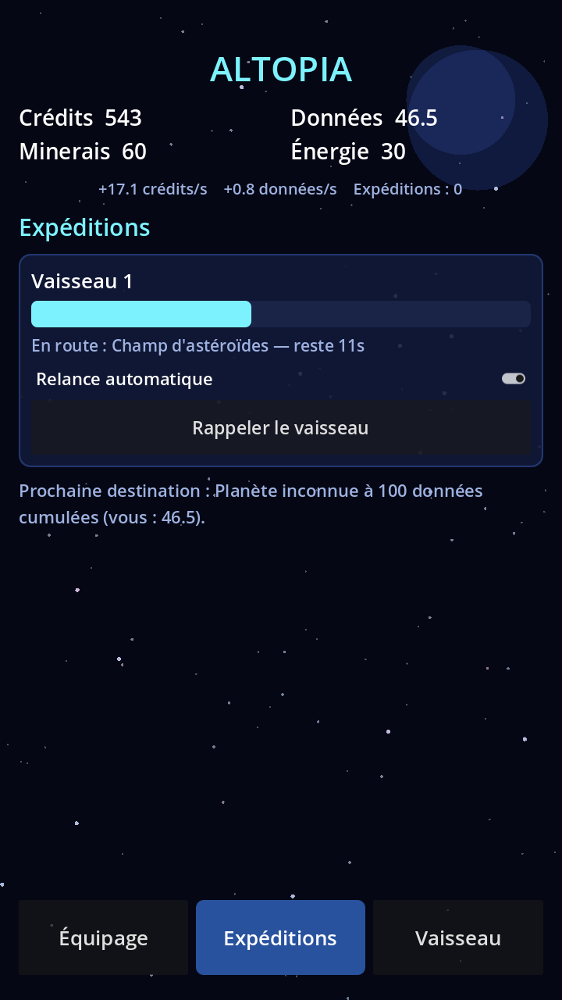

# Altopia V1 — maquette de la boucle de gameplay

Objectif : une boucle **complète, jouable et rejouable** sur téléphone, sans graphismes définitifs.

## La boucle (en 1 phrase)
Recruter un équipage → lancer des expéditions (astéroïdes / étoile / planète) →
récolter des ressources → améliorer le vaisseau → débloquer de nouvelles destinations → … même hors-ligne.

```
        ┌──────────────── ÉQUIPAGE ────────────────┐
        │ Crédits ──► recruter / améliorer rôles   │
        │ (revenu passif + synergies)              │
        └───────────────┬──────────────────────────┘
                        │ le bon rôle accélère et augmente les gains
                        ▼
        ┌──────────────── EXPÉDITIONS ─────────────┐
        │ Astéroïdes ► minerais   (Pilote)         │
        │ Étoile     ► énergie    (Ingénieur)      │
        │ Planète    ► données    (Scientifique)   │
        │ durée + gains, relance auto (AFK)        │
        └───────────────┬──────────────────────────┘
                        │ minerais / énergie / données / crédits
                        ▼
        ┌──────────────── VAISSEAU ────────────────┐
        │ Laser (+minerais)  Collecteur (+énergie) │
        │ Scanner (+données) Moteurs (-durée)      │
        │ Baie d'amarrage (2e vaisseau)            │
        └───────────────┬──────────────────────────┘
                        │ Données cumulées
                        ▼
          débloque Étoile (25) puis Planète (100)
```

## Écrans (portrait, barre d'onglets en bas)
```
┌────────────────────────┐   Haut permanent :
│ ALTOPIA                │   Crédits | Données | Minerais | Énergie
│ Cr 120  Do 14          │   + revenus par seconde
│ Mi  35  En  8          │
├────────────────────────┤
│  (contenu de l'onglet) │
│                        │
├────────────────────────┤
│ Équipage│Expéd.│Vaisseau│
└────────────────────────┘
```
- **Équipage** : 3 rôles (niveau, coût, effet) + synergie d'équipage.
- **Expéditions** : un ou deux vaisseaux ; choisir une destination ; barre de progression ;
  case « relance auto » ; dernier butin. Destination verrouillée tant que les Données cumulées sont insuffisantes
  ou si le rôle requis n'est pas recruté.
- **Vaisseau** : 5 améliorations achetées avec crédits + ressources d'expédition.

## Aperçu réel (capture du jeu)
  

Régénérer les captures : `xvfb-run -a godot --path . --rendering-driver opengl3 --rendering-method gl_compatibility --resolution 720x1280 -s tools/screenshot.gd -- docs/screens`
(les fichiers produits s'appellent `shot_*.png`).

## Règles chiffrées (V1, à équilibrer)
| Destination | Rôle | Durée | Gains de base | Déblocage |
|---|---|---|---|---|
| Champ d'astéroïdes | Pilote | 20 s | 5 minerais, 10 crédits, 1 donnée | départ |
| Étoile naine | Ingénieur | 45 s | 8 énergie, 20 crédits, 3 données | 25 données |
| Planète inconnue | Scientifique | 90 s | 12 données, 60 crédits, 3 minerais, 2 énergie | 100 données |

- Gains = base × (1 + 0,15 × niveau du rôle) × amélioration de la ressource × synergie.
- Durée = base ÷ ((1 + 0,10 × Moteurs) × (1 + 0,03 × niveau du rôle)).
- Hors-ligne : jusqu'à 8 h simulées (expéditions auto comprises), récap au retour.

## Hors périmètre V1
Combats/boss, événements aléatoires, prestige, anomalies, monétisation, vrais graphismes.
Prochaines étapes : événements de planète, boss de secteur, prestige.
