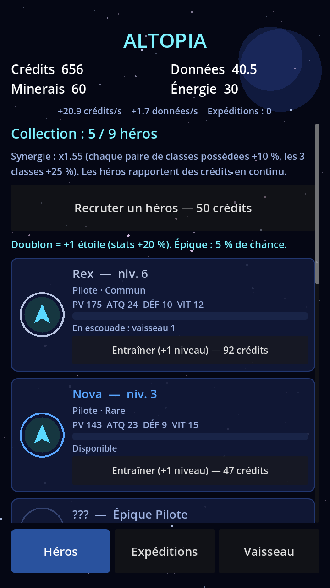
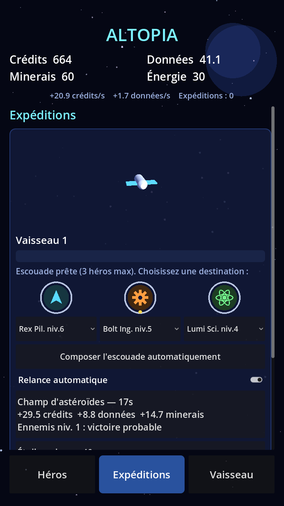
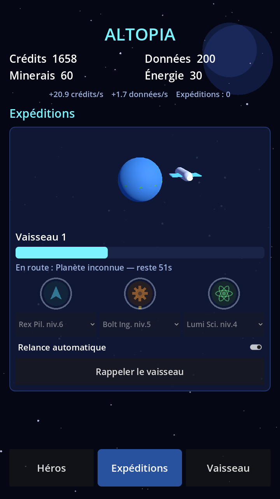
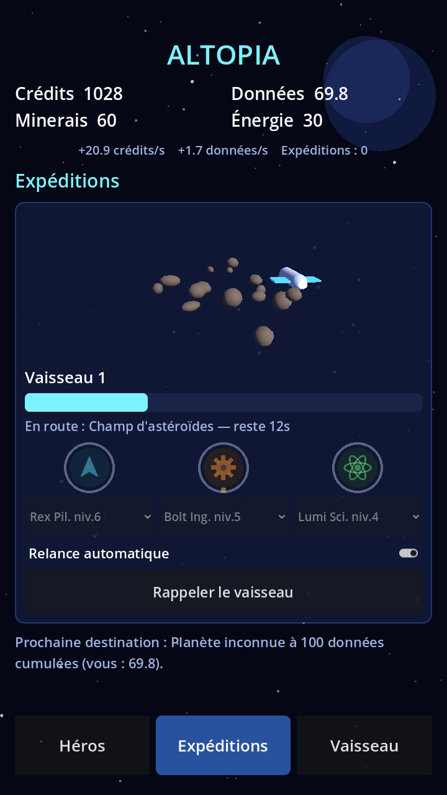
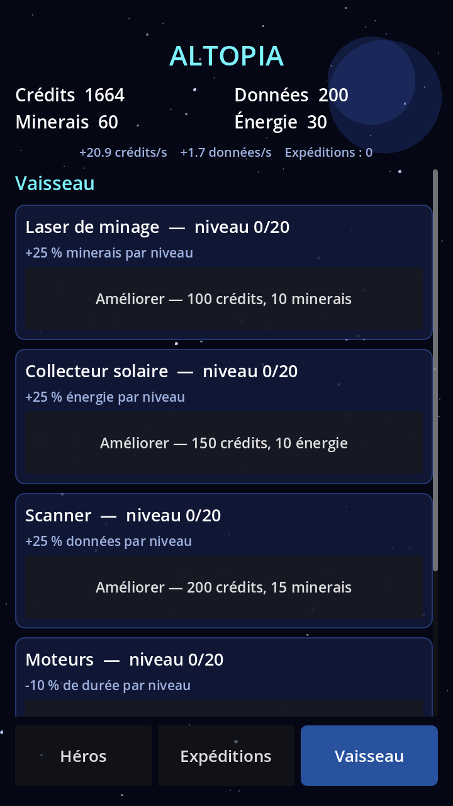

# Altopia V1 — boucle de gameplay RPG + idle

Un **RPG de collection** (héros, classes, raretés, niveaux, étoiles, escouades, combats automatiques)
dans un **jeu idle/AFK d'exploration spatiale** (expéditions, ressources, améliorations, hors-ligne).

## La boucle
```
 Crédits ──► RECRUTER des héros (aléatoire, doublon = +1 étoile)
                 │            ▲
                 ▼            │ XP + niveaux (victoires) / entraînement (crédits)
        Composer une ESCOUADE (3 héros max par vaisseau)
                 │
                 ▼
   EXPÉDITION : voyage (durée) ──► COMBAT AUTOMATIQUE contre les ennemis du lieu
                 │                        │
                 │ victoire : butin complet + XP      défaite : 25 % du butin, pas d'XP
                 ▼
   crédits / données / minerais / énergie ──► améliorations du VAISSEAU
                 │
   données cumulées ──► débloquent l'Étoile (25) puis la Planète (100)
   les ennemis montent d'un niveau toutes les 4 victoires : il faut progresser.
   Tout continue hors-ligne (jusqu'à 8 h simulées, relance auto comprise).
```

## RPG
- **9 héros** : 3 classes (Pilote, Ingénieur, Scientifique) × 3 raretés (Commun, Rare, Épique).
- Stats : PV, ATQ, DÉF, VIT. Niveau (+15 %/niv., jusqu'à 40) et étoiles (+20 %/étoile, jusqu'à 5).
- Recrutement : coût croissant (50 × 1,2ⁿ crédits) ; tirage 70 % commun / 25 % rare / 5 % épique ;
  un doublon donne une étoile (au maximum : remboursement partiel).
- Progression : XP gagnée à chaque victoire, entraînement payant.
- **Classe = spécialité** : l'escouade doit contenir la classe de la destination
  (Pilote → astéroïdes, Ingénieur → étoile, Scientifique → planète) ; les niveaux de cette classe
  augmentent les gains et réduisent la durée.
- **Synergies** : posséder des classes différentes augmente tous les revenus.
- **Combat** : au tour par tour automatique, déterministe (ordre par VIT, dégâts = ATQ − DÉF/2).
  L'écran affiche en avance « victoire probable / défaite probable ».

## Exploration
| Destination | Classe | Durée | Ennemis | Gains de base | Déblocage |
|---|---|---|---|---|---|
| Champ d'astéroïdes | Pilote | 20 s | 2 Foreurs rebelles | 5 minerais, 10 crédits, 3 données | départ |
| Étoile naine | Ingénieur | 45 s | 2 Sentinelles solaires | 8 énergie, 20 crédits, 6 données | 25 données |
| Planète inconnue | Scientifique | 90 s | 3 Créatures xéno | 16 données, 60 crédits, 3 minerais, 2 énergie | 100 données |

**Données** : les capteurs de bord en produisent 0,1/s en continu, les Scientifiques davantage, et chaque
expédition en rapporte. L'escouade est composée automatiquement au départ et à chaque recrutement
(bouton « Composer l'escouade automatiquement » pour la refaire).

## Vaisseau (améliorations)
Laser (+minerais), Collecteur solaire (+énergie), Scanner (+données), Moteurs (−durée),
Baie d'amarrage (2ᵉ vaisseau, donc 2ᵉ escouade).

## Visuel 2D / 3D
- **3D** : petite scène par vaisseau (planète qui tourne, étoile, champ d'astéroïdes en orbite)
  avec le vaisseau modélisé en 3D qui orbite. Rendu « compatibilité » (large support Android).
- **2D** : fond d'étoiles à 3 plans (parallaxe), portraits de héros dessinés en code
  (cadre de rareté, emblème de classe, étoiles), interface en cartes.
- Tous les visuels sont **procéduraux (provisoires)** : à remplacer par de vrais assets plus tard.

## Aperçu réel (captures du jeu)
| Héros | Expéditions (repos) | Planète | Astéroïdes | Vaisseau |
|---|---|---|---|---|
|  |  |  |  |  |

Tester le défilement/les taps tactiles : `xvfb-run -a godot --path . --resolution 720x1280 -s tools/touch_test.gd`.

Régénérer : `xvfb-run -a godot --path . --resolution 720x1280 -s tools/screenshot.gd -- docs/screens`
(produit `shot_*.png`).

## Hors périmètre / prochaines étapes
Animation visuelle des combats, équipements, boss de secteur, événements de planète, prestige,
vrais graphismes et sons, monétisation.
