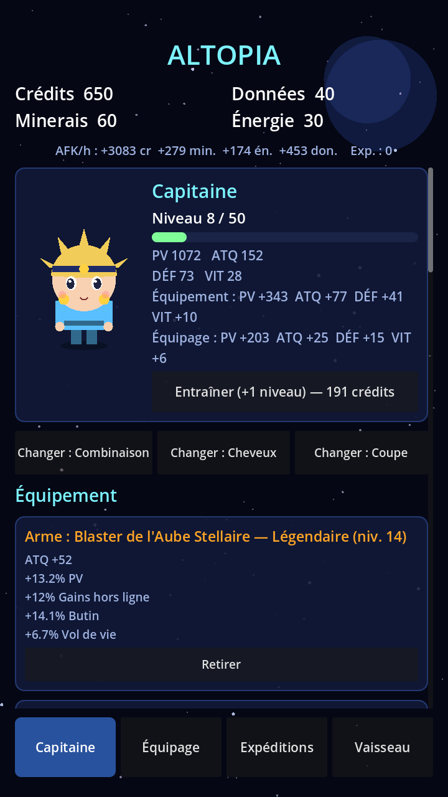
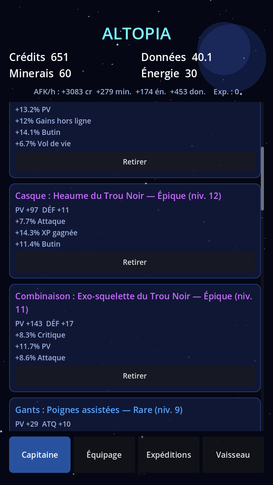
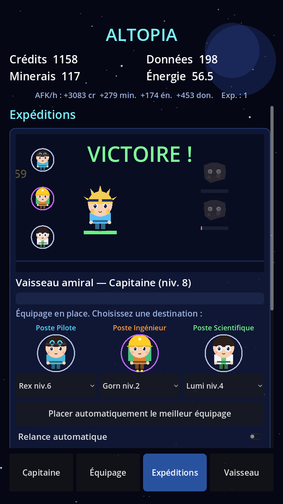

# Altopia V2 — Le Capitaine (inspiration : Mini Legion: Rise)

## Changement de cap
Le joueur n'est plus « un collectionneur de héros » : **il incarne le Capitaine du vaisseau**, un personnage
unique qu'il personnalise, fait monter de niveau et équipe. **L'équipage (Pilote, Ingénieur, Scientifique)
devient des objets** : des cartes à collectionner, à placer aux **postes** du vaisseau, qui donnent des
bonus au Capitaine et déterminent les expéditions possibles.

```
        CAPITAINE (le joueur)                      ÉQUIPAGE = objets à leurs postes
  niveau, PV / ATQ / DÉF / VIT      ◄── bonus ──   Poste Pilote      (carte Pilote)
  + ÉQUIPEMENT évolutif                            Poste Ingénieur   (carte Ingénieur)
    Arme · Combinaison · Module                    Poste Scientifique(carte Scientifique)
        │
        ▼ combat automatique (le Capitaine se bat)
   EXPÉDITIONS ──► butin : crédits, minerais, énergie, données + ÉQUIPEMENT (drops)
   ANOMALIES   ──► donjons solo rejouables (temps à battre)            [phase C]
   BOSS / TOUR ──► boss de secteur, tour d'épreuves                    [phase C]
   CAMPAGNE    ──► histoire par chapitres, un secteur à la fois        [phase D]
```

## Règles (phase A + B, en cours)
### Capitaine
- Stats de base 120 PV / 14 ATQ / 6 DÉF / 10 VIT, +15 %/niveau (niveau 50 max), XP gagnée à chaque victoire,
  entraînement payant. Apparence personnalisable (combinaison, cheveux, coupe).
- Stats finales = base + équipement + 35 % des stats de l'équipage placé aux postes (20 % pour la VIT).
### Équipage = la partie AFK (bonus même hors ligne)
- Les 9 cartes (3 classes × 3 raretés), niveaux, étoiles (doublons) : on les **place aux postes** du vaisseau
  (un poste par classe). **Seuls les équipiers placés travaillent.**
- Production par heure et par niveau, **active aussi hors ligne** : Pilote → minerais, Ingénieur → énergie,
  Scientifique → données, et tous → crédits. Multipliée par la rareté (×1 / ×1,4 / ×2), les étoiles (+20 %)
  et la **synergie des classes présentes aux postes** (paires +10 %, les 3 classes +25 %).
- Ils fixent aussi **le rendement et la durée hors ligne** : rendement 50 % de base, +2 % par niveau d'équipier placé
  (max 120 %) ; durée comptée 4 h de base, +15 min par niveau d'Ingénieur placé (max 24 h).
- Chaque équipier ajoute en plus 35 % de ses stats au Capitaine du vaisseau.
- **Vaisseau 2 (baie d'amarrage)** : un drone sans capitaine, piloté par l'équipage seul (stats réduites).
- Un poste vide = pas de production : c'est ce qui rend les cartes utiles même quand on ne joue pas.

### Équipement du Capitaine = du vrai loot RPG
- **6 emplacements** : Arme, Casque, Combinaison, Gants, Bottes, Module. On démarre avec l'arme et la combinaison.
- **5 raretés** : Commun, Peu commun, Rare, Épique, Légendaire (0 à 4 bonus aléatoires). Niveau d'objet selon la
  destination et le niveau des ennemis (+10 % de stats par niveau).
- **Bonus aléatoires** : % ATQ / PV / DÉF, vitesse, critique, vol de vie, XP gagnée, crédits, butin,
  **gains hors ligne** (l'équipement agit aussi sur l'AFK).
- Butin : 35 % de chance par victoire du vaisseau amiral (augmenté par les bonus « butin »).
- **Comparaison** avec l'objet équipé (▲ / ▼ puissance), **recyclage** en crédits, **recyclage automatique**
  réglable (désactivé, communs, jusqu'à peu commun, jusqu'à rare) pour ne pas crouler sous l'inventaire (60 objets).
- Combat : critique (dégâts moyens ×1,5 selon la chance) et vol de vie.

## Style visuel
Trois pistes dessinées pour choisir (« réaliste mais dessin animé ») : voir [STYLE.md](STYLE.md). Le style actuel du jeu est provisoire.

## Phases
- **A — Capitaine + équipage en objets** et **B — Équipement évolutif** : cette version.
- **E (avec A) — Style chibi** : personnages dessinés avec de la personnalité (tête, visage, accessoires par rôle).
- **C — Anomalies (donjons solo, meilleur temps), boss de secteur, tour d'épreuves.**
- **D — Campagne** : chapitres narratifs, un par secteur.

## Aperçu réel (captures du jeu)
| Capitaine | Équipement | Équipage | Expéditions |
|---|---|---|---|
|  |  |  |  |

| Astéroïdes | Planète | Combat en cours | Combat gagné |
|---|---|---|---|
|  |  |  |  |

## Outils de test
- `godot --headless --path . -s tests/run_tests.gd` : tests unitaires de la logique.
- `xvfb-run -a godot --path . --resolution 720x1280 -s tools/touch_test.gd` : simule des doigts (défilement, taps, listes).
- `xvfb-run -a godot --path . --resolution 720x1280 -s tools/screenshot.gd -- docs/screens` : génère les captures (`shot_*.png`).
